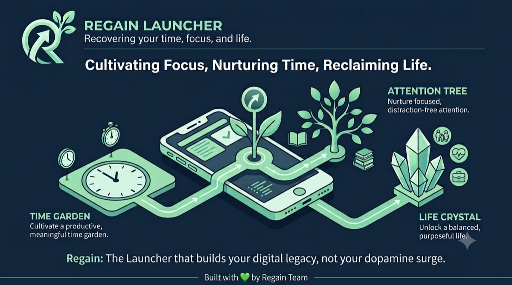
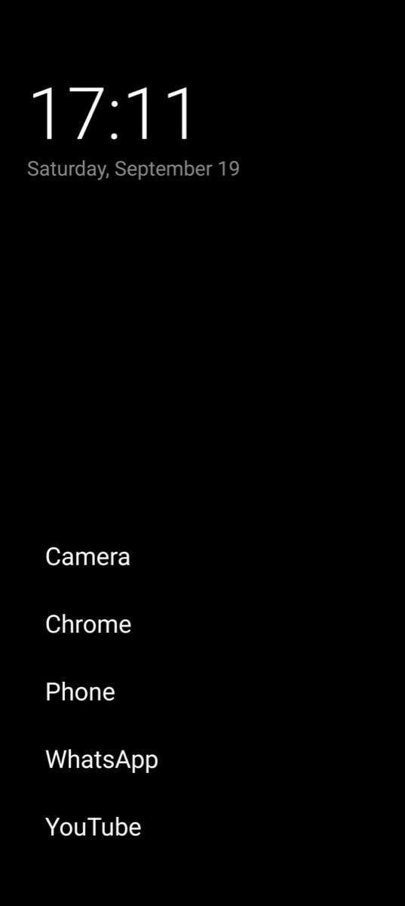
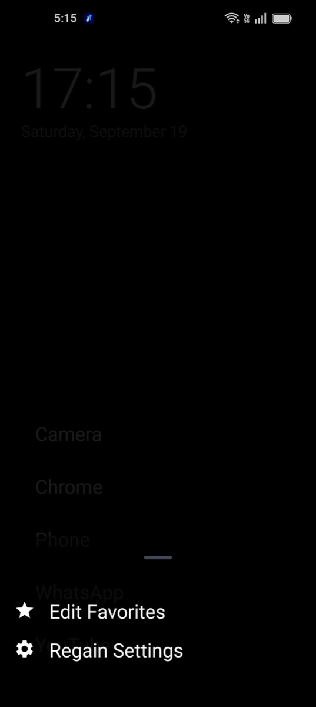
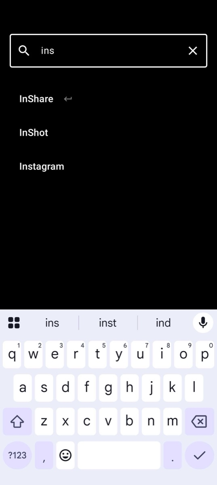
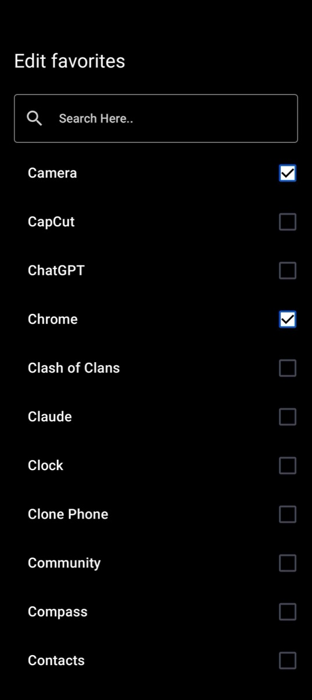

<p align="center">
  
</p>

# Regain

> Regain control of your life, attention, and time. A minimalist, text-only Android launcher that
> turns your phone from a dopamine casino back into a tool.

<p align="center">
  <a href="https://toyz-95.github.io/regain-releases/"><b>⬇ Download the APK</b></a> ·
  <a href="https://github.com/ToyZ-95/regain-releases/releases/latest">Latest release</a> ·
  <a href="https://github.com/ToyZ-95/regain-releases/releases">All versions</a>
</p>

Most launchers are built to maximise screen time: vivid icons, notification badges, endless
widgets. Regain does the opposite. **Friction is a feature.** It strips away the visual noise so
every unlock feels intentional.

This repository hosts the **official, signed APK releases** and the download website for Regain.

---

## Screenshots

<table>
<tr>
<td></td>
<td></td>
<td></td>
<td></td>
</tr>
<tr>
<td align="center">Home screen</td>
<td align="center">Quick menu</td>
<td align="center">Live search</td>
<td align="center">Edit favorites</td>
</tr>
</table>

---

## Features

- **Calm home screen**: a large live clock, the date, and up to 6 favorite apps as plain text.
- **A real launcher**: set Regain as your phone's default Home app.
- **Alphabetical app drawer**: swipe up for every installed app, with live search. The keyboard opens automatically and you can pull down to close.
- **Edit favorites**: choose your favorites; changes appear on the home screen instantly.
- **Hide distracting apps**: hide them from the home screen, drawer and favorites, and manage them in Settings → Hidden Apps.
- **Quick menu**: long-press the home screen, or any app, for App Info, favorite and hide actions.
- **Themes**: Light, Dark, AMOLED (true black), Dynamic Color (Android 12+) and Follow System.
- **In-app updates**: check for a new version in Settings → About & updates. Regain downloads it, verifies it and hands it to Android to install.
- **Subtle haptics** on key interactions.

Coming next: a mindful pause before opening distracting apps, usage insights and focus modes.

---

## Install

**Requirements:** Android 9 or newer.

1. Download the APK from the [website](https://toyz-95.github.io/regain-releases/) or the [latest release](https://github.com/ToyZ-95/regain-releases/releases/latest).
2. Open the downloaded file. If asked, allow your browser to **install unknown apps**.
3. Google Play Protect may warn that the app is from an unknown developer, because Regain is not on the Play Store yet. Tap **More details → Install anyway**.
4. Press your phone's **Home** button, choose **Regain**, then **Always**.

### Update, switch back, uninstall

- **Update:** use **Settings → About & updates** inside Regain, or install a newer APK over the old one. Your favorites and settings stay.
- **Switch back to your old launcher:** Android Settings → Apps → Default apps → Home app.
- **Uninstall:** switch launchers first, then uninstall Regain like any other app.

---

## Verify your download

Every official build is signed with the same certificate. Its SHA-256 fingerprint is:

```
45:EA:B2:7C:FB:DD:06:B9:F1:5C:FE:87:E4:58:EA:F5:72:9D:28:8F:2A:01:7C:65:72:FD:21:B6:6E:BE:04:19
```

Check the signing certificate (Android SDK build-tools):

```bash
apksigner verify --print-certs regain.apk
```

Check the file was not corrupted (put the matching `.sha256` file from the same release in the same folder):

```bash
shasum -a 256 -c regain.apk.sha256
```

Android also enforces this itself: an APK signed with a different certificate cannot install over Regain.

---

## Privacy

- No ads, no analytics, no trackers.
- The only network use is checking this project's public release information so Regain can tell you when an update exists. Nothing about you or your apps is sent.

---

## Release notes

Release notes for every version are on the [Releases page](https://github.com/ToyZ-95/regain-releases/releases).

## Feedback

Found a bug or have an idea? [Open an issue](https://github.com/ToyZ-95/regain-releases/issues).
